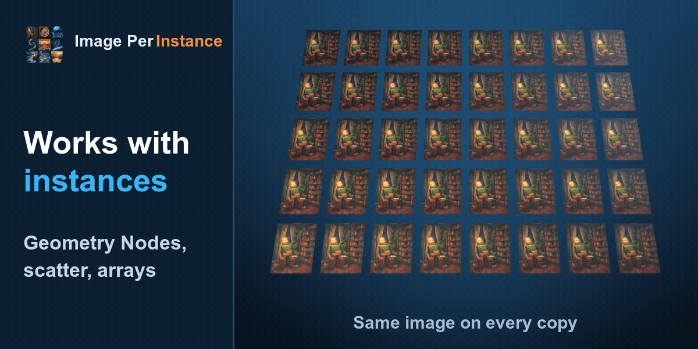
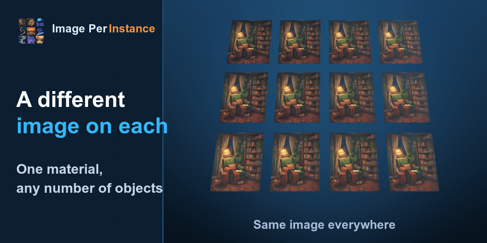
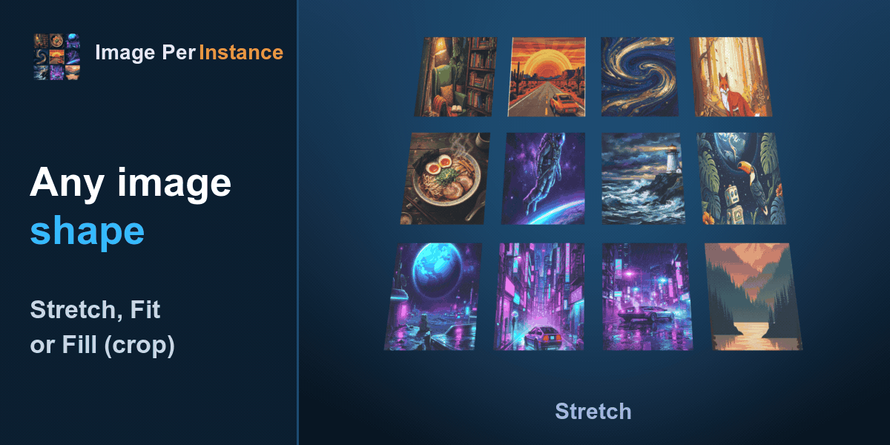
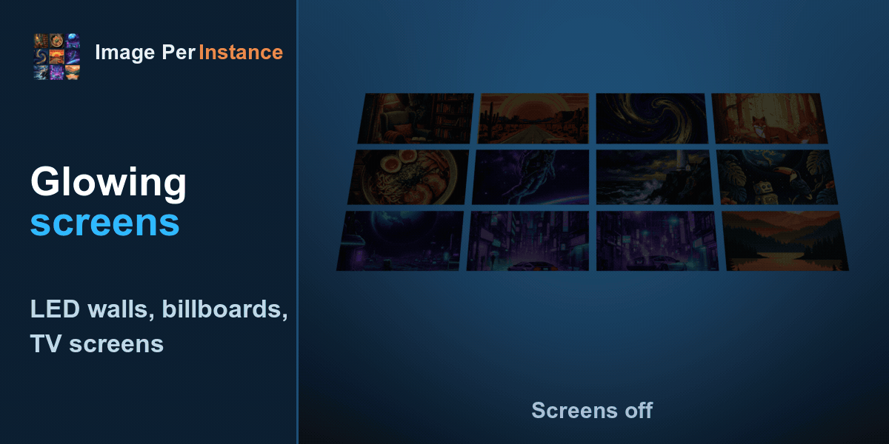
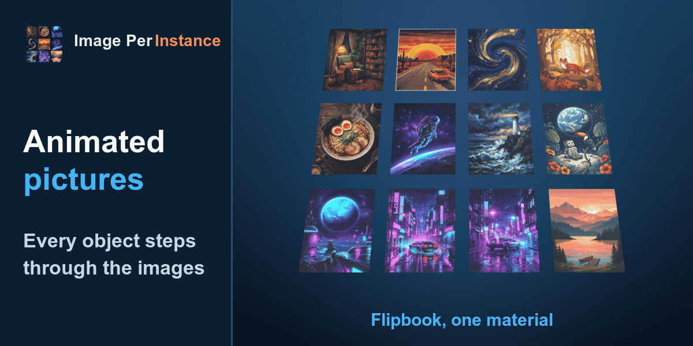
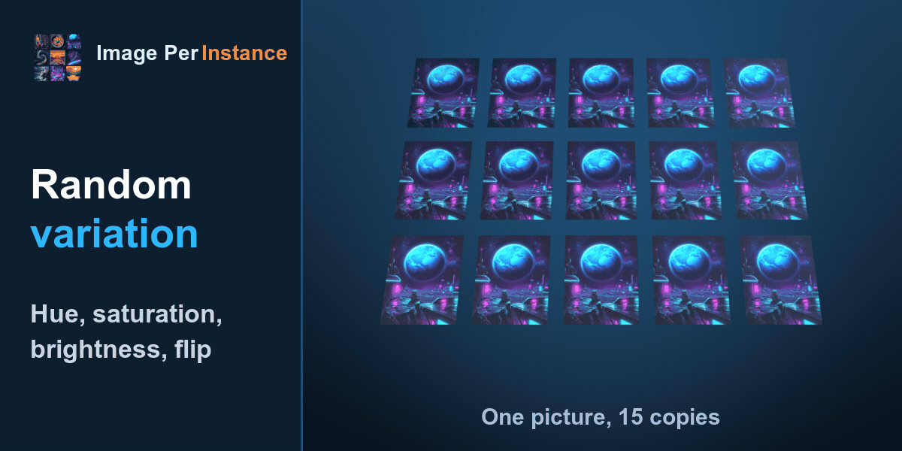

# Image Per Instance Lite — Blender add-on: a different image texture on every object, one shared material

Website: https://mendboxstudio.com/addons/image-per-instance · Full manual: https://mendboxstudio.com/docs/image-per-instance

**Full version — Geometry Nodes instances, fit modes (stretch / fit / fill), glowing screens, animated flipbook, random variation, more images → [Gumroad](https://mendbox.gumroad.com/l/image-per-instance) | [Superhive](https://superhivemarket.com/products/image-per-instance)**

Also on Blendkit (installs from inside Blender): [Lite](https://www.blendkit.com/asset-gallery-detail/83ecc781-045a-405e-9d98-f4b4664b7671/) | [full version](https://www.blendkit.com/asset-gallery-detail/53cec704-15b9-4601-984e-a192c8842f60/)

Image Per Instance Lite is a free, open-source Blender add-on that puts a different image on each object using **one shared material**. Pick a folder of images, press two buttons, done. No hand-built node setup, no 20 duplicated materials. For Blender 4.2 LTS, 4.5 LTS and 5.x.

[Download the latest release](https://github.com/mendbox/image-per-instance-lite/releases/latest) · [Video of the full version on YouTube](https://youtu.be/CLFAlI3Aa5c)

*A different image on every Geometry Nodes instance, one material (full version). [Get it on Gumroad](https://mendbox.gumroad.com/l/image-per-instance).*

## What Lite does

1. **Build Atlas** packs all images from a folder into one texture atlas stored inside your .blend.
2. **Apply To Selected Objects** gives every selected mesh its own image through one shared material.

Typical uses: posters and paintings on a wall, book covers, cards, tiles, game props, packaging, screens.

*A different image on each object, one material, any number of objects.*

## Lite vs Full

| Feature | Lite (free) | Full (paid) |
|---|:---:|:---:|
| Build Atlas from a folder, Apply To Selected Objects | yes | yes |
| One shared material for all objects | yes | yes |
| Images per atlas | up to 20 | no 20 image limit |
| Natural file order (`img2` before `img10`) | yes | yes |
| Geometry Nodes instances (Instance on Points, Array modifier) | no | yes |
| Shuffle | no | yes |
| Fit modes and tile shapes (stretch, fit, fill/crop) | no | yes |
| Assign images by object name | no | yes |
| Alpha and emission (glowing screens) | no | yes |
| Mapping for objects without UVs | no | yes |
| Animation (flipbook through the images) | no | yes |
| Random variation (hue, saturation, brightness, flip) | no | yes |

Lite stays free and complete for everything marked "yes". Get the full version on [Gumroad](https://mendbox.gumroad.com/l/image-per-instance) or [Superhive](https://superhivemarket.com/products/image-per-instance).

## Gallery (Full version only)

These need the full version, they are not in Lite.

*Works with Geometry Nodes instances: scatter and arrays, each instance its own picture.*

*Any image shape: Stretch, Fit or Fill (crop).*

*Glowing screens: emission for LED walls, billboards and TV screens, one material.*

*Animated pictures: every object steps through the images, one material.*

*Random variation per object: hue, saturation, brightness, flip.*

## Install (Blender 4.2 and newer)

1. Download the zip from the [Releases](https://github.com/mendbox/image-per-instance-lite/releases/latest) page. **Do not unzip it.**
2. In Blender open **Edit > Preferences > Get Extensions**, click the arrow menu at the top right and choose **Install from Disk**, then pick the zip.
3. In the 3D viewport press **N** and open the **Image Per Instance Lite** tab.

## Quick start

1. Choose the **Image Folder** and a **Tile Size**, press **Build Atlas**.
2. Select your objects and press **Apply To Selected Objects**.

Objects need UVs that fill the 0-1 square (a plane or an unwrapped cover). Images are resized to square tiles of one size. The image goes on material slot 1; other slots are not touched. Atlas size is limited to 16384 px per side.

## FAQ

### How do I put a different image on each object in Blender with one material?
Build one atlas that holds all images and let each object use its own tile of it, so all objects share the same material. This add-on does that: **Build Atlas** packs the folder, **Apply To Selected Objects** assigns one tile per object.

### How do I avoid making 20 duplicate materials for 20 pictures?
Use one material and one atlas texture instead of one material per image. The scene stays simpler: one material to edit instead of twenty.

### How do I texture picture frames, posters or book covers with different images?
Give each frame, poster or cover plane its own image from the folder. Objects need UVs that fill the 0-1 square (a plane or an unwrapped cover works).

### Does it work with Geometry Nodes instances, Instance on Points or the Array modifier?
Not in Lite. Lite works on separate objects. The full version adds Geometry Nodes instances, Instance on Points and Array support: [Gumroad](https://mendbox.gumroad.com/l/image-per-instance) | [Superhive](https://superhivemarket.com/products/image-per-instance).

### Is there an image limit in the free version?
Yes, up to 20 images per atlas. The full version has no 20 image limit.

### Does it work with Blender 5.x?
Yes. Works on Windows, macOS and Linux (Blender 4.2 LTS and newer). Automated tests pass on Blender 4.2.23, 4.5.14 and 5.2.2 (on macOS, Windows 11 and Linux): the test renders every tile and checks its colour, checks the 20 image limit and the empty-folder error. No internet, no external files, no binaries.

## Changelog

- **0.2.0**: natural file order (`img2` before `img10`), 16-bit and EXR images have the right brightness, the 3D view redraws right after a button press, rebuilding the atlas no longer shifts pictures
- **0.1.7**: the image goes only on material slot 1

## License

GPL-3.0-or-later. See [LICENSE](LICENSE). Support: support@mendboxstudio.com

---
*Keywords: Blender add-on, Blender extension, different texture on each object, image per object, one material many images, texture atlas, image texture, picture frames, posters, book covers, Geometry Nodes instances, product visualization.*
